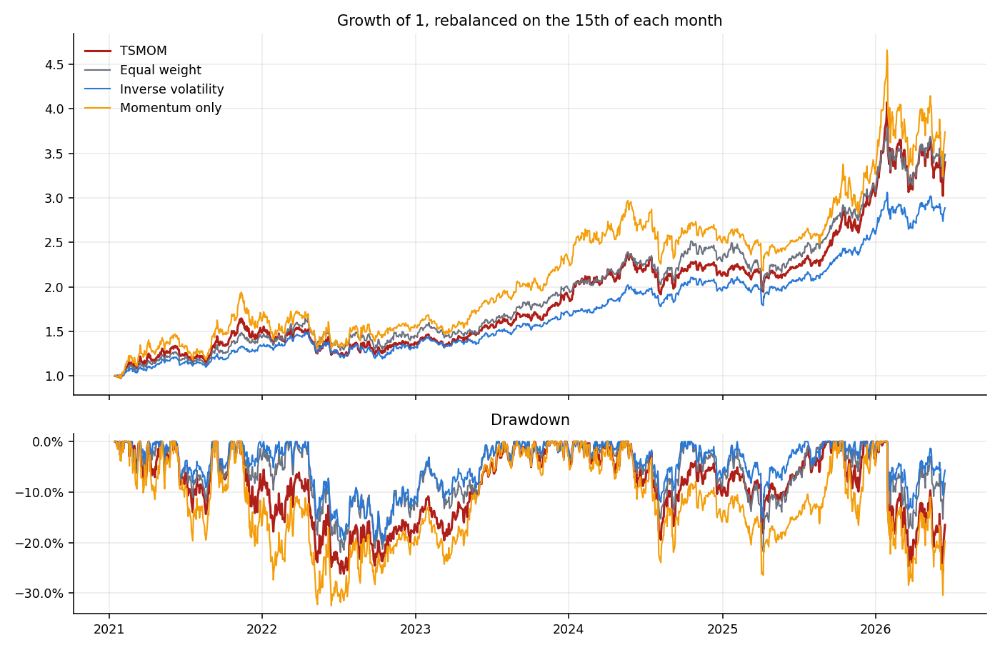
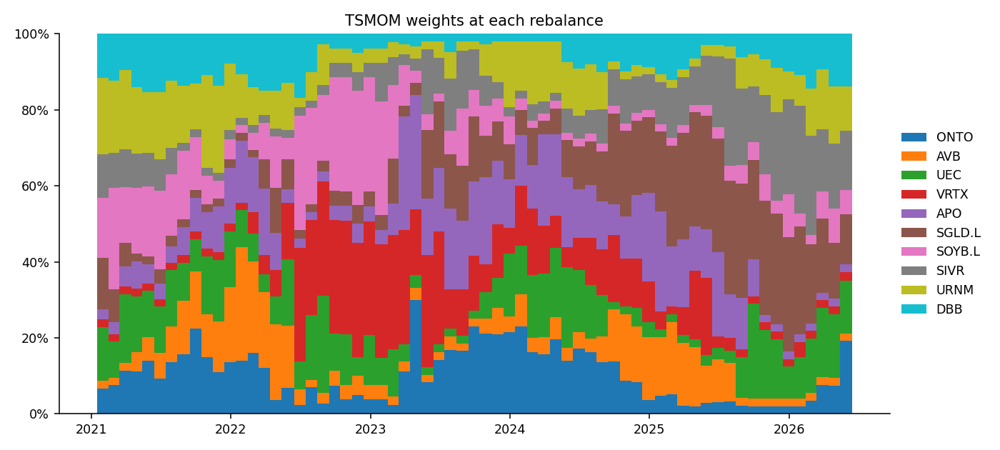
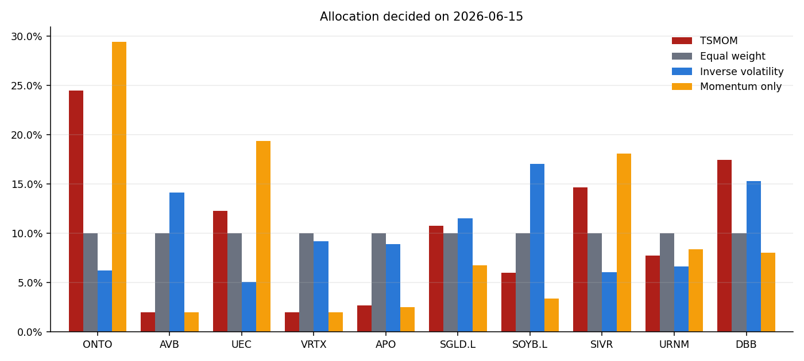
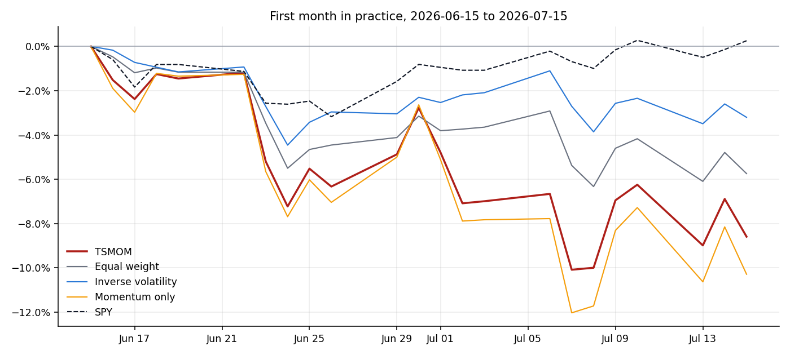

# Desk study: monthly momentum allocation, June 2026

This folder is the research record. It is frozen: the data, the code path and the
results below describe the decision the desk made on 15 June 2026 and what happened
in the month after it. The interactive dashboard in `dashboard/` is a separate tool
and does not read anything from here.

## The question

The desk's analysts picked ten assets for the portfolio: five equities and five
commodity products. The analysts chose *what* to hold. The open question was *how
much* of each to hold, and how to keep that up to date without a weekly debate.

We wanted a rule that:

- uses only prices, so it can be run the same way every month,
- leans towards assets that have been trending up,
- holds less of the assets that move the most,
- never drops an analyst pick entirely and never lets one dominate.

## The basket

| Ticker | Name | Class |
| --- | --- | --- |
| ONTO | Onto Innovation | Equity |
| AVB | AvalonBay Communities | Equity |
| UEC | Uranium Energy Corp | Equity |
| VRTX | Vertex Pharmaceuticals | Equity |
| APO | Apollo Global Management | Equity |
| SGLD.L | Invesco Physical Gold ETC | Commodity |
| SOYB.L | WisdomTree Soybeans ETC | Commodity |
| SIVR | abrdn Physical Silver Shares ETF | Commodity |
| URNM | Sprott Uranium Miners ETF | Commodity |
| DBB | Invesco DB Base Metals Fund | Commodity |

The list is in `universe.json`. London listings are converted to USD.

## The rule (TSMOM)

On each rebalance date:

1. Momentum is the return from 12 months ago to 1 month ago. The latest month is
   skipped because short-term moves tend to reverse.
2. Volatility is the annualized standard deviation of the last 252 daily returns.
3. The score is momentum divided by volatility. Negative scores count as zero.
4. Every asset gets a 2% floor. The rest is shared in proportion to the scores.
5. No asset can hold more than 30%. Any excess is spread over the others.

An asset needs 13 months of prices before it can be held. Weights are set on the
15th of each month (or the next trading day) and drift with prices until the next
rebalance.

We compared it against three simpler rules on the same basket:

- **Equal weight**: 10% each.
- **Inverse volatility**: weight proportional to 1 / volatility, with the 2% floor.
- **Momentum only**: the TSMOM score without the volatility scaling or the cap.

The code is in `momentum/` at the repository root and is shared with the dashboard.

## Backtest before the decision

Monthly rebalances from 15 January 2021 (the first date when every asset had 13
months of history) to 15 June 2026. Uninvested cash earns the 3-month Treasury
rate. Turnover is one-way and excludes the first purchase.

| Strategy | Annual return | Volatility | Sharpe | Max drawdown | Avg turnover |
| --- | --- | --- | --- | --- | --- |
| TSMOM | +25.3% | 23.0% | 0.96 | -26.2% | 14.8% |
| Equal weight | +25.9% | 21.2% | 1.06 | -21.9% | 3.4% |
| Inverse volatility | +21.6% | 16.1% | 1.13 | -20.0% | 3.1% |
| Momentum only | +27.6% | 30.5% | 0.79 | -32.5% | 17.1% |



What we took from this:

- TSMOM did not beat the simple rules on a risk-adjusted basis. Equal weight and
  inverse volatility had higher Sharpe ratios and smaller drawdowns.
- The volatility scaling and the cap did their job relative to raw momentum: a
  similar return with a third less volatility and a shallower drawdown.
- The test uses today's basket on past data. The analysts picked these names
  knowing how they had done, so every rule here looks better than it would have
  in real time.

The desk still chose TSMOM because it was the only rule that responds to trends in
the basket, which was the point of the exercise. The backtest was treated as a
sanity check, not as evidence of an edge.



## The allocation on 15 June 2026

| Asset | TSMOM | Equal weight | Inverse volatility | Momentum only |
| --- | --- | --- | --- | --- |
| ONTO | 24.5% | 10.0% | 6.2% | 29.4% |
| AVB | 2.0% | 10.0% | 14.1% | 2.0% |
| UEC | 12.3% | 10.0% | 5.1% | 19.4% |
| VRTX | 2.0% | 10.0% | 9.2% | 2.0% |
| APO | 2.7% | 10.0% | 8.9% | 2.5% |
| SGLD.L | 10.7% | 10.0% | 11.5% | 6.8% |
| SOYB.L | 6.0% | 10.0% | 17.0% | 3.4% |
| SIVR | 14.6% | 10.0% | 6.1% | 18.1% |
| URNM | 7.7% | 10.0% | 6.6% | 8.4% |
| DBB | 17.4% | 10.0% | 15.3% | 8.0% |



TSMOM put about 70% into ONTO, DBB, SIVR, UEC and SGLD.L, the names with the
strongest trends. AVB and VRTX had negative momentum and sat at the 2% floor.

## The first month: 15 June to 15 July 2026

The June weights were held without trading until 15 July.

| Strategy | Return | Versus SPY | Worst contributor |
| --- | --- | --- | --- |
| TSMOM | -8.59% | -8.84% | SIVR -2.59% |
| Equal weight | -5.74% | -6.00% | SIVR -1.77% |
| Inverse volatility | -3.20% | -3.46% | SIVR -1.07% |
| Momentum only | -10.29% | -10.54% | SIVR -3.21% |
| SPY | +0.25% | | |



It was a bad month for the allocation. The basket fell while the S&P 500 was flat,
and TSMOM lost more than the simple rules because it was overweight the assets that
had trended hardest: silver, uranium and ONTO all gave back part of their gains.
This is the known weakness of momentum. When trends turn, it is positioned on the
wrong side until the signal catches up, and a single month says little about
whether the rule works. Full per-asset contributions are in
`results/first_month_contributions.csv`.

### Stand-in prices

Two assets have no usable prices after 15 June on Yahoo Finance, so the first month
uses close substitutes for them. The June weights are unchanged; only the
first-month returns are borrowed.

| Asset | Stand-in | Why |
| --- | --- | --- |
| AVB | ESS (Essex Property Trust) | Coastal apartment REIT, daily correlation 0.88 with AVB over the two years to June 15 |
| SOYB.L | SOYB (Teucrium Soybean Fund) | Same commodity, US listing, weekly correlation 0.92 with SOYB.L |

Together they were 8% of the TSMOM portfolio and added +0.44% to its first-month
return. Had both been flat instead, TSMOM would still have lost about 9%.

## Limitations

- One basket, one month of live results. Nothing here is statistically significant.
- The basket was chosen with hindsight, which flatters every backtest above.
- No trading costs or taxes. TSMOM trades about 15% of the portfolio a month.
- Yahoo adjusted closes; London ETCs converted at daily GBP/USD closes.

## Reproduce

```bash
pip install -r requirements-research.txt
python -m research.run_study
```

The script reads only the frozen files in `data/` and rewrites everything in
`results/`:

| File | Contents |
| --- | --- |
| `data/prices.csv` | Daily USD closes to 15 June 2026, as used for the decision |
| `data/risk_free.csv` | 3-month Treasury yield (FRED DGS3MO), as a decimal |
| `data/first_month.csv` | Closes from 15 June to 15 July 2026, with the stand-ins and SPY |
| `results/summary.md` | All tables above |
| `results/*.csv` | Metrics, allocation, first-month values and contributions |
| `results/figures/` | The four charts |
